# 🛡️ Zero-Trust Software Supply Chain Pipeline (SLSA Level 3 Compliant)

[](#)
[](#)
[](#)
[](#)
[](#)
[](#)

An enterprise-grade, end-to-end **DevSecOps Software Supply Chain Security Pipeline** that ensures **zero-trust container deployment** on Amazon EKS. 

This project implements strict **Shift-Left security gates**, automated **SBOM (Software Bill of Materials)** generation, **cryptographic container signing**, **keyless cloud authentication via AWS OIDC**, and **Kubernetes admission control enforcement**.

---

## 📌 Executive Summary & Threat Model

In standard CI/CD pipelines, container registries trust any image pushed to them, and Kubernetes clusters deploy any container requested. This creates severe attack vectors:
1. **Source Code & Secret Tampering:** Leaked API keys or insecure application code reaching production.
2. **Third-Party Dependency Vulnerabilities:** Unpatched CVEs and supply-chain attacks (e.g., Log4Shell, SolarWinds).
3. **Container Tampering & Spoofing:** Man-in-the-middle attacks modifying images in transit or deploying rogue, unsigned images.
4. **Static Credential Compromise:** Long-lived `AWS_ACCESS_KEY_ID` secrets stored in CI platforms getting leaked.

**This project eliminates these risks by enforcing a Zero-Trust chain of custody from git commit to cluster runtime.**

---

## 🏗️ Architecture & Pipeline Flow

The pipeline executes a clean, boustrophedon (snake-layout) flow with dedicated security checkpoints:

```mermaid
flowchart TD
    %% High-Contrast Styling (Dark text on distinct colored cards)
    classDef stage1 fill:#f1f5f9,stroke:#334155,stroke-width:2px,rx:10px,ry:10px,color:#0f172a;
    classDef stage2 fill:#fee2e2,stroke:#dc2626,stroke-width:2px,rx:10px,ry:10px,color:#7f1d1d;
    classDef stage3 fill:#fef3c7,stroke:#d97706,stroke-width:2px,rx:10px,ry:10px,color:#78350f;
    classDef stage4 fill:#dcfce7,stroke:#16a34a,stroke-width:2px,rx:10px,ry:10px,color:#14532d;
    classDef stage5 fill:#e0e7ff,stroke:#4f46e5,stroke-width:2px,rx:10px,ry:10px,color:#1e1b4b;

    %% ==========================================
    %% ROW 1: Moves Left -> Right
    %% ==========================================
    subgraph R1 ["Phase 1: Code & Shift-Left Checks (Left to Right ➔)"]
        direction LR
        S1["<b>STAGE 1</b><br/>Python FastAPI<br/>App Code"]:::stage1
        S2["<b>Secret Scanning</b><br/>Gitleaks scans git history<br/>for secrets & keys"]:::stage1
        S3["<b>SAST Scan</b><br/>Semgrep scans code logic<br/>for OWASP bugs"]:::stage1
        S4["<b>Hardened Dockerfile</b><br/>Multi-stage build with<br/>non-root UID 10001"]:::stage1

        S1 --> S2 --> S3 --> S4
    end

    %% ==========================================
    %% ROW 2: Moves Right -> Left
    %% ==========================================
    subgraph R2 ["Phase 2: Vulnerability Auditing & Supply Chain (Right to Left 🠔)"]
        direction RL
        S5["<b>Trivy Scan</b><br/>Scans container image<br/>& filesystem for CVEs"]:::stage2
        S6["<b>Build & Push</b><br/>Push hardened image<br/>to GitHub Registry"]:::stage2
        S7["<b>SBOM Generation</b><br/>Syft generates CycloneDX<br/>inventory of dependencies"]:::stage2

        S5 --> S6 --> S7
    end

    %% ==========================================
    %% ROW 3: Moves Left -> Right
    %% ==========================================
    subgraph R3 ["Phase 3: Signing, Tagging & Orchestration (Left to Right ➔)"]
        direction LR
        S8["<b>Cosign Image Signing</b><br/>Cryptographically sign<br/>image digest with key-pair"]:::stage3
        S9["<b>Kustomize Auto-Tag</b><br/>Dynamically injects new<br/>commit SHA tag"]:::stage3
        S10["<b>JSON Artifacts</b><br/>Upload security reports<br/>& SBOM as build artifacts"]:::stage3
        S11["<b>Modular Workflow</b><br/>Master CI calls reusable<br/>Terraform infra pipeline"]:::stage3

        S8 --> S9 --> S10 --> S11
    end

    %% ==========================================
    %% ROW 4: Moves Right -> Left
    %% ==========================================
    subgraph R4 ["Phase 4: Cloud Infrastructure & Admission Control (Right to Left 🠔)"]
        direction RL
        S12["<b>AWS IAM OIDC</b><br/>Keyless authentication<br/>(No static AWS secrets)"]:::stage4
        S13["<b>Terraform EKS & VPC</b><br/>Provisions cluster (v1.30)<br/>with S3 state lockfile"]:::stage4
        S14["<b>Kyverno Admission</b><br/>Enforces policy: blocks<br/>any unsigned image"]:::stage5
        S15["<b>Production EKS Pods</b><br/>Verified, signed workload<br/>executes on worker nodes"]:::stage5

        S12 --> S13 --> S14 --> S15
    end

    %% ==========================================
    %% Straight Down Vertical Connections (No Diagonals!)
    %% ==========================================
    S4 ==>|Straight Down| S5
    S7 ==>|Straight Down| S8
    S11 ==>|Straight Down| S12
```

```

---

## 🛡️ Core DevSecOps Pillars

### 1. Shift-Left Application Security
* **Secret Scanning (Gitleaks):** Scans the entire Git commit tree (`fetch-depth: 0`) to detect leaked AWS credentials, tokens, and private keys before code can be merged.
* **Static Application Security Testing (SAST - Semgrep):** Scans source code logic against the OWASP Top 10 ruleset to catch vulnerabilities (e.g., injections, unsafe deserialization) at compile time.
* **Software Composition Analysis (SCA - Trivy):** Audits application dependencies in `requirements.txt` against known CVE databases.
* **Audit Trail Compliance:** Every scanner exports machine-readable JSON reports uploaded as permanent build artifacts.

### 2. Least-Privilege Container Hardening
* **Multi-Stage Architecture:** Build tools, compilers, and caches are discarded in the builder stage.
* **Non-Root Execution:** The production container runs strictly as an unprivileged user (`UID 10001`, `appuser`) with a disabled shell (`/sbin/nologin`), completely mitigating container escape risks.
* **Attack Surface Reduction:** Built on minimal Python runtime images, dropping unnecessary system binaries.

### 3. Supply Chain Security (SLSA Level 3 & SBOM)
* **CycloneDX SBOM Generation (Anchore Syft):** Automatically inspects and catalogs every installed OS library and Python wheel, creating an immutable software nutrition label (`sbom.cyclonedx.json`).
* **Cryptographic Image Signing (Sigstore Cosign):** Digitally signs the unique image digest (SHA-256) and pushes the signature payload directly to the OCI registry (`ghcr.io`).

### 4. Zero Static Cloud Secrets (AWS IAM OIDC)
* **Elimination of Long-Lived Keys:** Replaced permanent `AWS_ACCESS_KEY_ID` and `AWS_SECRET_ACCESS_KEY` secrets with **AWS IAM OpenID Connect (OIDC)** federated authentication.
* **Anti-Hijacking Scoping:** The trust policy is strictly bound to GitHub's immutable subject claim (`repo:<owner>@<id>/<repo>@<id>:*`), preventing repository rename hijacking.

### 5. Infrastructure as Code (Terraform 1.10+)
* **Amazon EKS (v1.30):** Provisioned with Amazon Linux 2023 (`AL2023_x86_64_STANDARD`) managed node groups.
* **Multi-AZ Network Isolation:** Custom VPC with public subnets for load balancers and private subnets for worker nodes with a single cost-optimized NAT Gateway.
* **Native S3 State Locking:** Implements Terraform 1.10+ native S3 state locking (`use_lockfile = true`) without requiring external DynamoDB tables.

### 6. Kubernetes Admission Control (Kyverno)
* **Policy-as-Code:** Kyverno intercepts every `Pod` creation request at the Kubernetes API server boundary.
* **Enforce Mode:** Validates image signatures against `cosign.pub` in real-time. Unsigned images, tampered layers, or unverified registries are blocked with a `403 Forbidden` error.

---

## 📁 Repository Structure

```text
.
├── .github/
│   └── workflows/
│       ├── security-pipeline.yml   # Master pipeline (Shift-Left, Docker, SBOM, Cosign)
│       └── infra-pipeline.yml      # Reusable Terraform pipeline (EKS, VPC, OIDC)
├── application/
│   ├── app.py                      # Production FastAPI microservice
│   ├── requirements.txt            # Python dependencies
│   ├── Dockerfile                  # Hardened multi-stage non-root containerfile
│   └── .dockerignore               # Image packaging ignore rules
├── k8s/
│   ├── deployment.yaml             # K8s Deployment and ClusterIP Service
│   ├── kustomization.yaml          # Kustomize manifest for dynamic SHA tagging
│   └── verify-image-policy.yaml    # Kyverno ClusterPolicy for Cosign validation
├── terraform/
│   ├── backend.tf                  # S3 remote state with native use_lockfile
│   ├── provider.tf                 # AWS and Terraform provider configurations
│   ├── vpc.tf                      # Multi-AZ VPC module with private subnets
│   ├── eks.tf                      # EKS cluster module (v1.30, AL2023 node group)
│   ├── oidc.tf                     # GitHub Actions OIDC provider and IAM role
│   └── outputs.tf                  # Cluster outputs & kubeconfig commands
└── cosign.pub                      # Public key for cluster-side image verification
```

---

## 🧪 Verification & Live Proof

### Test 1: Deploying an Unsigned / Rogue Container
When an unverified image is submitted to the cluster:

```bash
kubectl run rogue-pod --image=ghcr.io/google-samples/microservices-demo/emailservice:v0.3.5
```

**Result: Instantly blocked at the admission boundary:**
```text
Error from server (Forbidden): admission webhook "mutate.kyverno.svc" denied the request: 

resource Pod/default/rogue-pod was blocked due to the following policies

verify-image-signature-policy:
  verify-cosign-signature: no matching signatures found for ghcr.io/google-samples/microservices-demo/emailservice:v0.3.5
```

---

### Test 2: Deploying the Signed Pipeline Container
When our cryptographically signed container is deployed via Kustomize:

```bash
kubectl apply -k k8s/
```

**Result: Admitted and executing on worker nodes:**
```text
deployment.apps/secure-payment-app created
service/secure-payment-svc created

NAME                                  READY   STATUS    IP           NODE
secure-payment-app-7988d578b5-x8q2l   1/1     Running   10.0.1.196   ip-10-0-1-196.ec2.internal
```

---

## 🚀 Getting Started

### Prerequisites
* [Docker Desktop](https://www.docker.com/) / Podman
* [Terraform >= 1.10.0](https://www.terraform.io/)
* [AWS CLI v2](https://aws.amazon.com/cli/)
* [Cosign CLI](https://github.com/sigstore/cosign)
* [kubectl](https://kubernetes.io/docs/tasks/tools/)

### Local Provisioning
```bash
# 1. Clone the repository
git clone https://github.com/himanshu2oo4/Zero-Trust-Software-Supply-Chain-Pipeline-SLSA-Compliant.git
cd Zero-Trust-Software-Supply-Chain-Pipeline-SLSA-Compliant

# 2. Provision EKS infrastructure with Terraform
cd terraform
terraform init
terraform apply -auto-approve

# 3. Update local kubeconfig
aws eks update-kubeconfig --name devsecops-eks-cluster --region ap-south-1

# 4. Install Kyverno Admission Controller
kubectl create -f https://github.com/kyverno/kyverno/releases/download/v1.11.4/install.yaml

# 5. Apply the Image Signature Verification Policy
kubectl apply -f ../k8s/verify-image-policy.yaml
```

---

## 📈 Roadmap & Next Steps

* [x] Shift-Left Security Scanners (Gitleaks, Semgrep, Trivy)
* [x] Multi-stage non-root container hardening
* [x] CycloneDX SBOM generation (Syft)
* [x] Cryptographic signing & attestation (Cosign)
* [x] Keyless AWS IAM OIDC infrastructure
* [x] Zero-Trust Admission Controller (Kyverno)
* [ ] **Upcoming Companion Project:** Real-time Kubernetes Runtime Threat Detection & Automated Pod Quarantine using **eBPF, Falco, and Cilium NetworkPolicies**.
* [ ] **GitOps Integration:** Automated synchronization with **ArgoCD**.

---

## 👨‍💻 Author

**Himanshu**  
*DevOps & DevSecOps Platform Engineer*  
* [GitHub Profile](https://github.com/himanshu2oo4)  
* [LinkedIn](https://linkedin.com)
